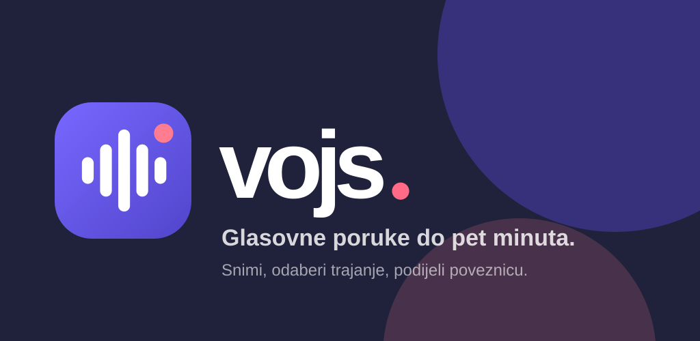
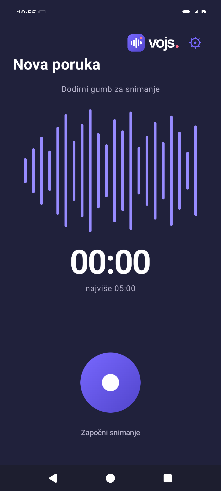
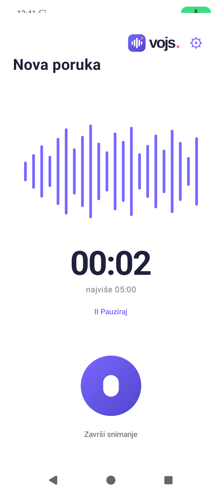
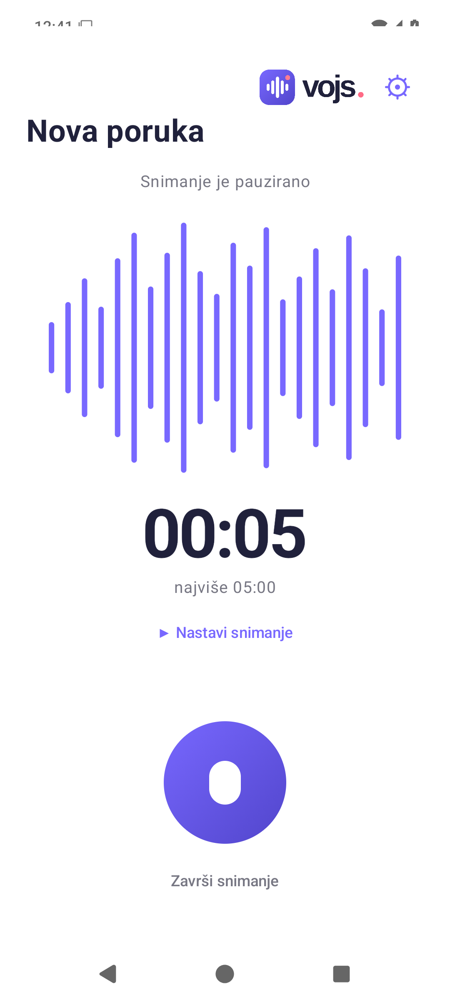
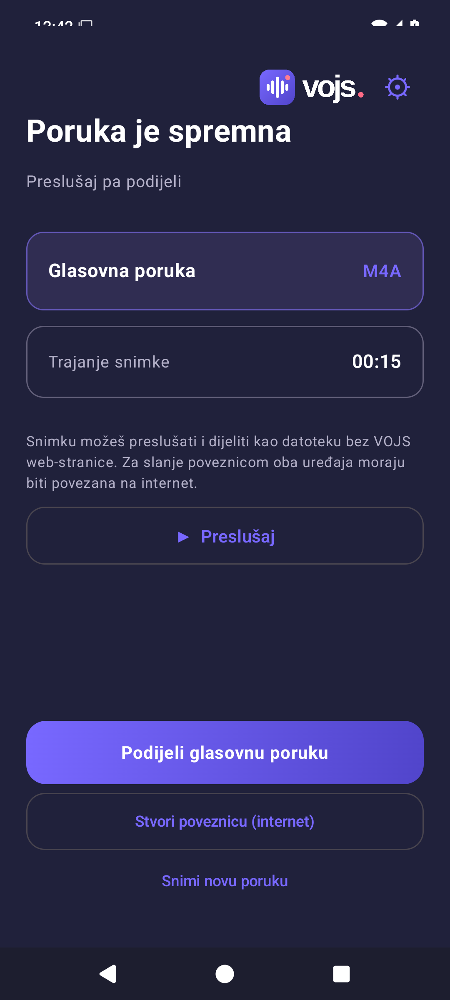
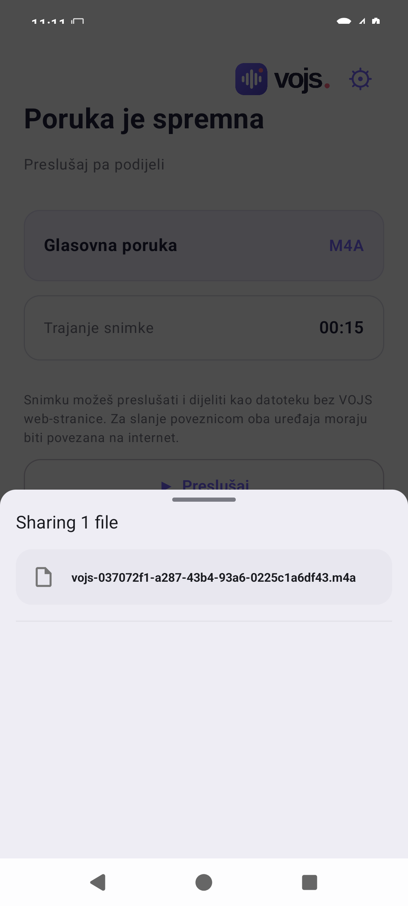
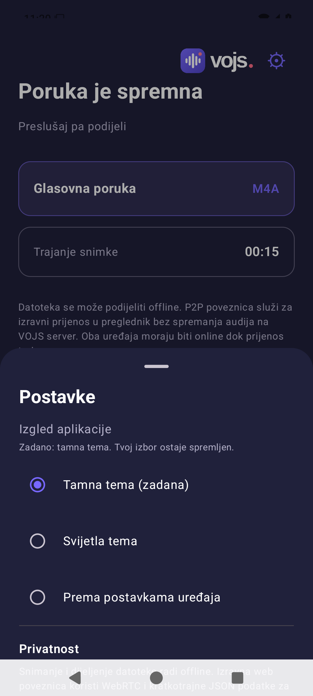
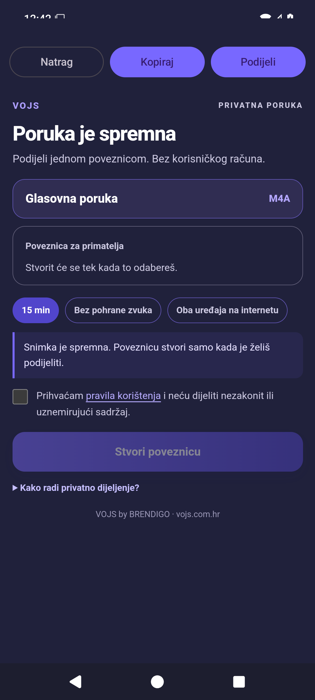
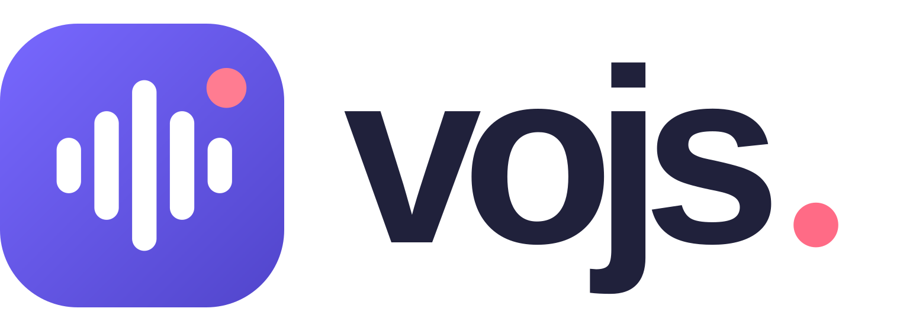

  

  # VOJS

  ### Neke stvari bolje zvuče.

  **Snimi glas. Preslušaj. Podijeli trenutak.**

  Glasovne poruke bez prijave, bez nepotrebnih koraka i bez obvezne internetske veze.

  [**Preuzmi VOJS za Android**](https://github.com/bren-wp/Vojs/releases/latest) · [**Otvori web aplikaciju**](https://vojs.com.hr) · [**Pravila privatnosti**](https://vojs.com.hr/privatnost/)

  

---

## Glas koji ostaje tvoj

VOJS pretvara kratku misao, čestitku ili poruku u snimku koju možeš preslušati i podijeliti. Snimaj do **5 minuta**, pauziraj, nastavi i spremi zvuk na uređaju. Nema obveznog korisničkog računa.

| 🎙️ Snimi i preslušaj | 📱 Podijeli bez web-stranice | 🔗 Pošalji poveznicu |
| --- | --- | --- |
| Snimaj, pauziraj i nastavi u aplikaciji. | Pošalji M4A datoteku putem izbornika za dijeljenje na uređaju. | Kada imaš internet, stvori privatnu vremenski ograničenu poveznicu. |
| **Radi bez interneta.** | **VOJS server nije potreban.** | **Oba uređaja moraju biti online.** |

### Stvarni zasloni Android aplikacije

Slike su izravne snimke VOJS aplikacije na Android emulatoru, bez umjetno nacrtanih zaslona. Prikazuju stvarne kontrole, tamnu temu i tijek snimanja.

<table>
  <tr>
    <td align="center"> <strong>Nova poruka</strong></td>
    <td align="center"> <strong>Snimanje</strong></td>
    <td align="center"> <strong>Pauza i nastavak</strong></td>
  </tr>
  <tr>
    <td align="center"> <strong>Preslušavanje</strong></td>
    <td align="center"> <strong>Dijeljenje datoteke</strong></td>
    <td align="center"> <strong>Postavke</strong></td>
  </tr>
</table>

### Pošalji glas, ne račun

<strong>Kako funkcionira dijeljenje poveznicom?</strong>

Nakon snimanja odaberi **Stvori poveznicu (internet)**. Pošalji je primatelju i ostani u aplikaciji dok primatelj ne preuzme poruku. Poveznica vrijedi najviše **15 minuta**.

Zvuk se prenosi izravno između uređaja putem šifrirane veze. VOJS poslužitelj ne sprema audio datoteke; za uspostavu veze privremeno obrađuje mrežne i signalizacijske podatke. Povezivanje može zakazati na nekim mrežama, pa je dijeljenje M4A datoteke uvijek dostupna alternativa.

## Tvoj izgled. Tvoj izbor.

- **Tamna tema** uključena je pri prvom otvaranju.
- **Svijetla tema** dostupna je u postavkama, uz opciju praćenja izgleda uređaja.
- **Bez obvezne prijave, oglasa i ugrađene analitike.**
- **Bez interneta:** snimaj, pauziraj, preslušavaj, koristi izbornik za dijeljenje datoteke i čitaj pravila privatnosti unutar aplikacije.

## Privatnost je važna

Snimke ostaju lokalno dok ih sam ne podijeliš. Za izravno dijeljenje poveznicom web usluga obrađuje kratkotrajne podatke o povezivanju, a STUN poslužitelj može vidjeti mrežne informacije. Primatelj može zadržati primljenu kopiju.

[Pravila privatnosti](https://vojs.com.hr/privatnost/) · [Uvjeti korištenja](https://vojs.com.hr/uvjeti/) · [Prijava sadržaja](https://vojs.com.hr/prijava-sadrzaja/)

## VOJS za Android i web

| Android aplikacija | Web aplikacija |
| --- | --- |
| Lokalno snimanje, preslušavanje i M4A dijeljenje bez VOJS web-stranice. | Snimanje u pregledniku, preuzimanje i dijeljenje kada preglednik to podržava. |
| Izravno dijeljenje poveznicom samo kada ga korisnik odabere. | Primanje snimke izravno od pošiljatelja dok je povezan. |

**Android izdanja:** [GitHub Releases](https://github.com/bren-wp/Vojs/releases). Za Google Play potreban je zasebno verificiran i potpisan produkcijski paket; testna i nepotpisana izdanja nisu paketi za objavu na Play Storeu.

---

  

  **VOJS by BRENDIGO**

  [Web](https://vojs.com.hr) · [Izdanja](https://github.com/bren-wp/Vojs/releases) · [Kontakt](https://vojs.com.hr/kontakt/) · [Tehnička dokumentacija](docs/GOOGLE-PLAY-READY.md)

