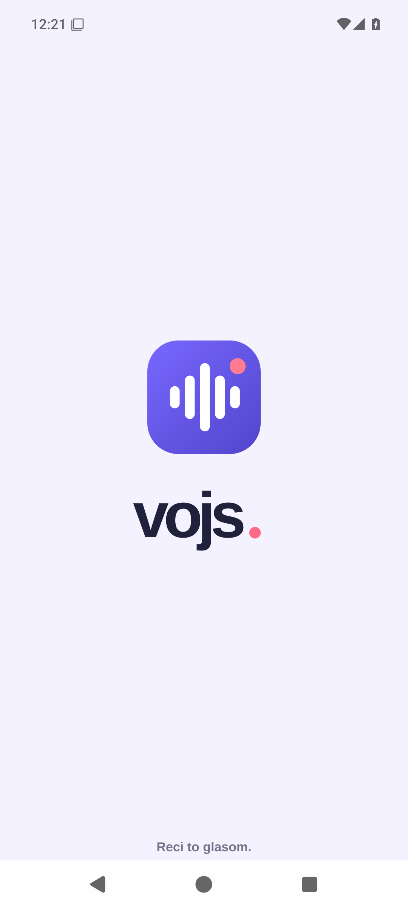
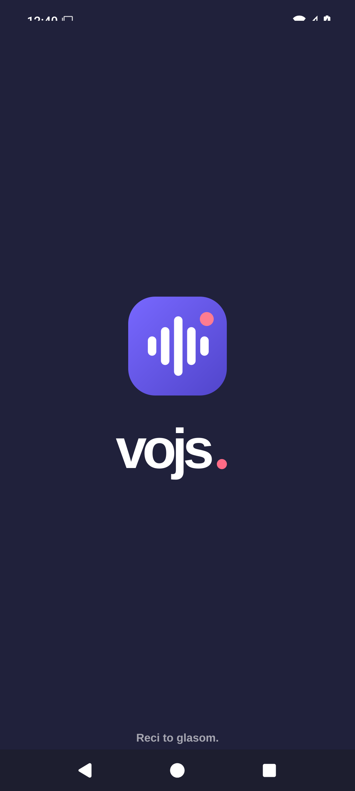

<div align="center">


# VOJS

### Neke stvari bolje zvuče.

**Snimi glas. Preslušaj poruku. Podijeli trenutak.**

Nativna Android aplikacija za glasovne poruke do pet minuta — **bez računa, oglasa i VOJS servera**.

[📲 Preuzmi najnovije izdanje](https://github.com/bren-wp/Vojs/releases/latest) · [🌐 VOJS web](website/) · [💜 BRENDIGO](https://brendigo.com)

</div>

---

## 🎙️ Tvoj glas. Tvoja poruka.

Neke poruke zaslužuju se čuti. VOJS omogućuje da u nekoliko dodira snimiš glasovnu poruku, poslušaš je i podijeliš kao M4A audio datoteku kroz Androidov sustav dijeljenja.

| 🎤 Snimi | 🎧 Preslušaj | 📤 Podijeli |
| :---: | :---: | :---: |
| Do 5 min, pauza i nastavak | Provjeri poruku prije slanja | Android Sharesheet / M4A |

## 🎬 Originalni splash — 2,5 sekunde

VOJS koristi originalne neizmijenjene 1080 × 2400 PNG grafike svijetle i tamne teme iz
[branding/pocetni-zaslon/](branding/pocetni-zaslon/). Nativni splash prikazuje se **2,5 sekunde**,
bez rezanja slike. Prilikom prvog pokretanja Android kratko prikazuje i vlastiti sistemski splash.

Emulator workflow snima stvarne prikaze kao
[svijetli splash](docs/screenshots/00-splash-light.png) i
[tamni splash](docs/screenshots/10-splash-dark.png).
Rezultati usporedbe s originalnim slikama nalaze se u
[splash-pixel-audit.json](docs/screenshots/splash-pixel-audit.json).
Snimke su snimljene na Android emulatoru i uspoređene s originalnim 1080 × 2400 slikama. Posljednja potvrđena analiza oba splasha pokazuje 0 % promijenjenih piksela u mjerenim područjima (bez Androidovih sistemskih traka).

<table>
  <tr>
    <td align="center" width="50%"><br/><strong>Svijetli splash</strong></td>
    <td align="center" width="50%"><br/><strong>Tamni splash</strong></td>
  </tr>
</table>

## 📱 Stvarni zasloni aplikacije

Svih devet funkcionalnih snimki (uz oba gornja splasha, ukupno **11 stvarnih prikaza**) dolazi iz **stvarnog izvođenja Android aplikacije na emulatoru Pixel 6 (API 35)**, tijekom automatiziranih provjera funkcija. Nisu marketinški mockupovi; snimke uključuju i izvorni VOJS logotip.

<table>
  <tr>
    <td width="33%" align="center"><br/><strong>Početni zaslon</strong></td>
    <td width="33%" align="center"><br/><strong>Snimanje</strong></td>
    <td width="33%" align="center"><br/><strong>Poruka spremna</strong></td>
  </tr>
  <tr>
    <td width="33%" align="center"><br/><strong>Android dijeljenje</strong></td>
    <td width="33%" align="center"><br/><strong>Postavke</strong></td>
    <td width="33%" align="center"><br/><strong>Pauza</strong></td>
  </tr>
  <tr>
    <td width="33%" align="center"><br/><strong>Tamne postavke</strong></td>
    <td width="33%" align="center"><br/><strong>Tamna tema — poruka</strong></td>
    <td width="33%" align="center"><br/><strong>Tamna tema — početak</strong></td>
  </tr>
</table>

📷 [Pogledaj sve stvarne snimke zaslona](docs/screenshots/) · [Automatsko testiranje zaslona](https://github.com/bren-wp/Vojs/actions/workflows/screenshots.yml)

## 🎚️ Kalibracija kontrola snimanja

Gumb za snimanje i završetak ostaje na dnu zaslona, a pauza/nastavak nalazi se ispod brojača. Time se zadržava izvorna vizualna hijerarhija iz VOJS reference i ne gubi funkcionalnost pauziranja. Valni prikaz, razmaci i položaj naslova prilagođeni su mjerenjima prema originalnom grafičkom konceptu; njihova stvarna podudarnost ponovno se provjerava kroz Android emulator.

## 🎼 Valni prikaz prema stvarnim ROI mjerenjima

Duljina i razmak 22 valne linije rekonstruirani su iz dostavljene originalne VOJS reference, umjesto približnog algoritamskog profila. Pomičemo valni prikaz u izvornu poziciju i sužavamo raspored linija, bez uklanjanja reagiranja na mikrofon. Nakon svakog izdanja automatski objavljujemo izmjerenu razliku u `recording-pixel-audit.json`; prikaz živog zvuka i promjenjivo vrijeme mogu imati odstupanja od statične reference.

## 🎯 Mjerljiva 1:1 kalibracija

Automatski test uspoređuje stvarnu snimku zaslona za snimanje s izvornim VOJS konceptom iz `branding/google-play/snimke-zaslona/`. Budući da koncept prikazuje ekran unutar okvira telefona, slika se najprije normalizira na odgovarajući sadržaj zaslona, a zatim se računaju odstupanja po područjima (zaglavlje, valni oblik, vrijeme, kontrole). Dinamičko vrijeme i podaci mikrofona prirodno utječu na pikselnu razliku.

[Izvještaj mjerenja](docs/screenshots/recording-pixel-audit.json) stvara se iz **stvarnog emulator-testiranja** i nije zamjena za ručnu provjeru svih zaslona. Cilj je postupno smanjivati odstupanje; 0 % zasad nije dokazano.

## 🎛️ Postavke i tamna tema

Aplikacija podržava svijetlu, tamnu i automatsku temu, pristupačne kontrole za snimanje, pauziranje, nastavak, reprodukciju i izravno dijeljenje. Prikazi su snimljeni stvarnim Android emulatorom, ne generirani.

Postavke, pauza i oba načina prikaza dokumentirani su stvarnim snimkama u gornjoj galeriji.

## ✨ Zašto VOJS?

- **⚡ Brzo** — otvoriš, snimiš, poslušaš, podijeliš.
- **🔒 Privatno na uređaju** — nema VOJS clouda, baze podataka ni korisničkih računa.
- **✈️ Offline** — snimanje i preslušavanje ne zahtijevaju internet.
- **💬 Tvoj izbor primatelja** — Android nudi kompatibilne aplikacije poput Bluetootha, Quick Sharea, poruka, WhatsAppa ili Vibera (ovisno o instaliranim aplikacijama).
- **🟣 Izvorni gumb za dijeljenje** — ljubičasti vodoravni gradijent kao u VOJS grafičkom konceptu, uz izvorni Android Sharesheet.
- **🎨 BRENDIGO identitet** — glavna boja `#7868FF`, tamna `#5145CB` i naglasak `#FF7C91`.

## 🔐 Privatnost bez skrivenih obećanja

VOJS sprema snimku **privremeno u privatni cache uređaja** da bi Android FileProvider omogućio pouzdano dijeljenje. Cache stariji od 24 sata briše se pri sljedećem pokretanju aplikacije. Aplikacija ne šalje zvuk na vlastite servere. Vanjska aplikacija preko koje korisnik dijeli zvuk može koristiti svoje servere i trajno zadržati kopiju.

VOJS ne stvara javne web-poveznice i ne može opozvati već predanu audio datoteku. Dopuštenje za mikrofon koristi se za snimanje glasa.

## 📦 APK i AAB izdanja

[**Preuzmi najnoviji VOJS na GitHub Releases**](https://github.com/bren-wp/Vojs/releases/latest)

Svaka uspješna Android build objava na `main` grani automatski stvara novo verzionirano izdanje:

| Datoteka | Namjena |
| :--- | :--- |
| `VOJS-vX-debug.apk` | Instalacijski APK za **testiranje**, potpisan debug ključem |
| `VOJS-vX-unsigned.apk` | Nepotpisani release APK |
| `VOJS-vX-unsigned.aab` | Nepotpisani AAB, **nije spreman za Google Play** |

Kad su konfigurirane tajne `VOJS_KEYSTORE_BASE64`, `VOJS_STORE_PASSWORD`, `VOJS_KEY_ALIAS`, `VOJS_KEY_PASSWORD`, workflow potpisuje produkcijski APK/AAB. Za stabilna ažuriranja potrebno je čuvati isti produkcijski ključ. Debug APK iz odvojenih CI pokretanja može imati različit certifikat i nije namijenjen za produkcijske nadogradnje.

## 🛠️ Razvoj i izgradnja

```bash
gradle :app:assembleDebug :app:assembleRelease :app:bundleRelease
```

Izvorni kod: `app/` · statični web: `website/` · CI: `.github/workflows/`.

## 🌐 Web VOJS

U `website/` nalazi se **13 responzivnih statičnih stranica** usklađenih sa stvarnim mogućnostima aplikacije bez servera. Web ostaje u repozitoriju; nema GitHub Pages workflowa.

Originalni predrenderirani web i kompletni binarni brending mogu se zasebno uvesti skriptom [import_original_assets.py](scripts/import_original_assets.py). Njihov izvorni dizajn služi kao referenca; navedena statična prezentacija nije još verificirana kao 1:1 kopija.

---

<div align="center">

**VOJS by BRENDIGO**

[brendigo.com](https://brendigo.com) · [GitHub](https://github.com/bren-wp/Vojs)

</div>

## 🖌️ Vizualne reference

Izvorni dizajn je dostavljen u `VOJS-Android-brending-1.0.0.zip`. Nativni zasloni sada koriste valni prikaz, veliko vrijeme, okrugli gumb i raspored iz referenci. **Potpuna pikselna podudarnost nije potvrđena mjerenjem**, a reference koje prikazuju web-poveznice i vremensko brisanje opisuju serverske funkcije koje ova offline aplikacija namjerno nema.

**Cijeli izvorni web i brending već su u repozitoriju** u [source-archives/](source-archives/). Automatski [import-original-assets.yml](.github/workflows/import-original-assets.yml) provjerava SHA256 te izdvaja 87 web i 55 brending datoteka na `main` bez web deploya. Prava radna web prezentacija ostaje u `website/` i **ne objavljuje se automatski**.

## Stabilnost emulator testova

Android emulator može tijekom pokretanja prikazati sistemsku poruku "Quickstep isn't responding" ili "Pixel Launcher isn't responding". Taj dijalog prekriva VOJS, ali ne dokazuje rušenje VOJS aplikacije. Test zaustavlja nepotrebni launcher i po potrebi oporavlja isključivo takve sistemske dijaloge; VOJS ANR i dalje se smatra greškom. Snimke se smiju objaviti tek nakon uspješne provjere.

## 🧪 Kontrola izvornog vizualnog identiteta

Android koristi **originalne logotipe** iz `branding/logotip/` u svijetloj i tamnoj temi. Oni se kopiraju pri svakom Gradle buildu. Iz aplikacije su uklonjeni marketinški potpisi i tehničke poruke. Stvarne snimke Android zaslona ostaju u `docs/screenshots/` i obnavljaju se emulator workflowom. 0 % pikselnog odstupanja još nije potvrđeno usporednim mjerenjem.

## ✅ Google Play spremnost i nadograđene ovisnosti

Projekt koristi kompatibilan stabilni alatni lanac: AGP 8.13.2, Gradle 8.14.4, Kotlin 2.4.21, Compose BOM 2026.06.01 (posljednja kompatibilna Compose 1.11 linija), Activity 1.13.0, Core 1.18.0 i Core SplashScreen 1.2.0. `targetSdk=36` zadovoljava trenutačni Google Play cilj za telefone. Detalji i preostale ručne provjere nalaze se u [Google Play popisu provjera](docs/GOOGLE-PLAY-READY.md) i [pravilima privatnosti](docs/PRIVACY-POLICY.md). Potpisani produkcijski AAB zahtijeva zaseban ključ i Play Console provjere. Nepotpisani AAB nije spreman za slanje u Google Play.

## 🧭 Responzivno zaglavlje

Android zaglavlje zadržava **originalni VOJS logotip** u odvojenoj kompaktnoj alatnoj traci; naslov zaslona sada ima cijelu dostupnu širinu, pa na manjim telefonima ne dolazi do sudara ili neželjenog prelamanja uz logotip i gumb postavki. Raspored se provjerava snimkama iz stvarnog emulatora. Vizualna podudarnost svih područja 1:1 mora se nastaviti mjeriti, ne pretpostavljati.
