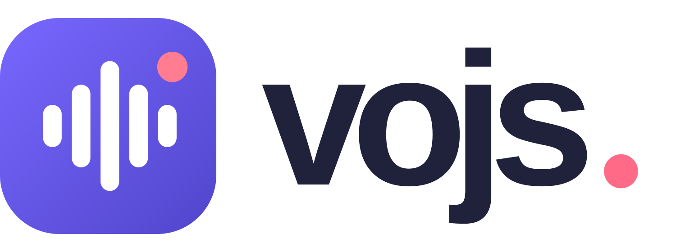
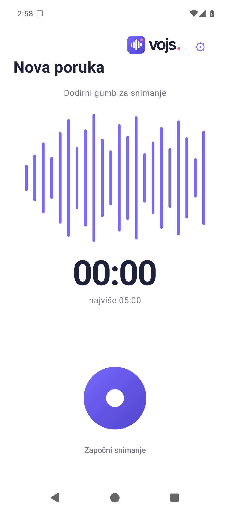
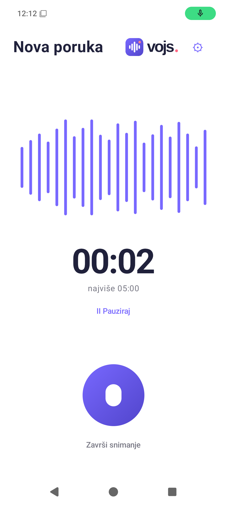
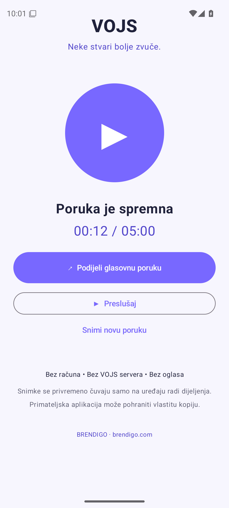
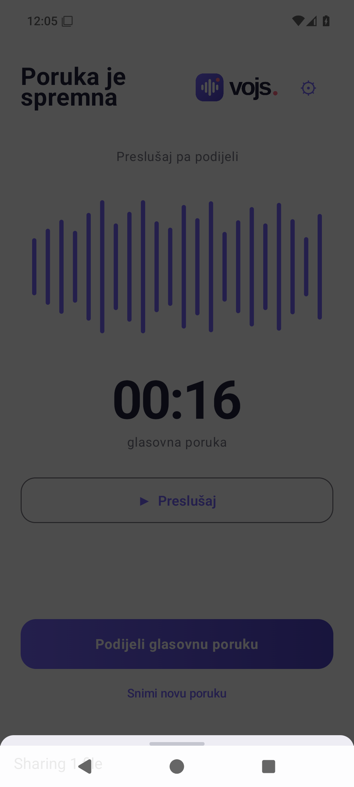
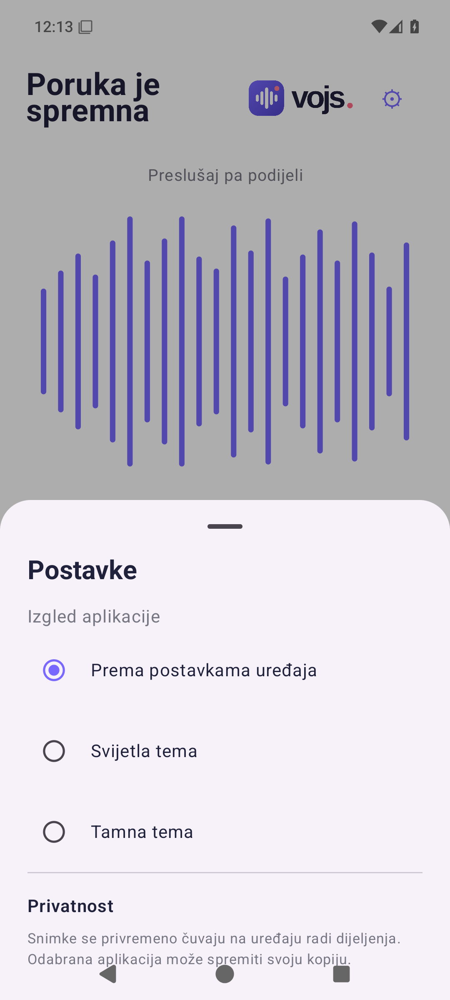
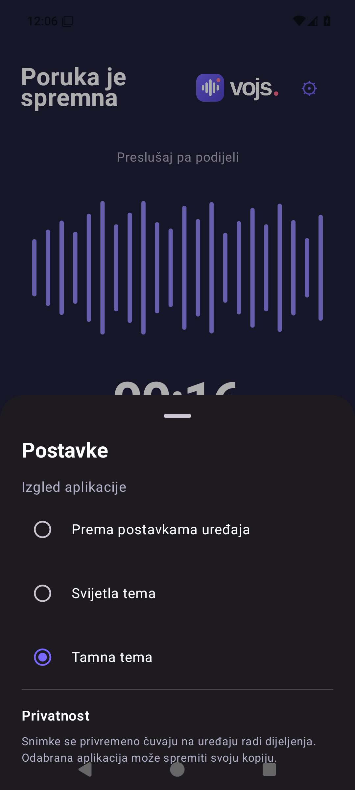
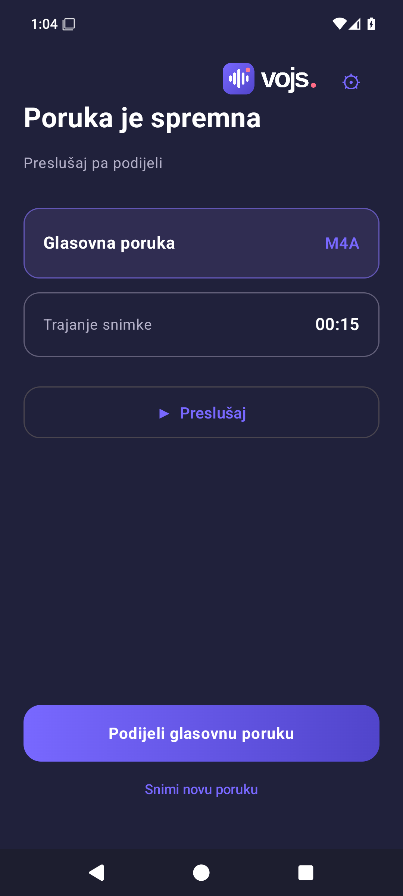
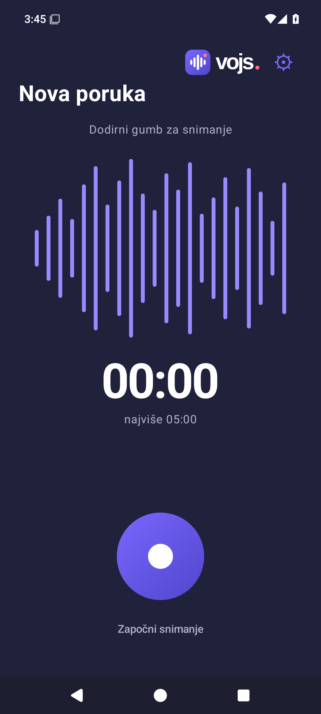

<div align="center">



# VOJS

### Neke stvari bolje zvuče.

**Snimi glas. Preslušaj poruku. Podijeli trenutak.**

Nativna Android aplikacija za glasovne poruke do pet minuta — **bez računa, oglasa i VOJS servera**.

[📲 Preuzmi najnovije izdanje](https://github.com/bren-wp/Vojs/releases/latest) · [🌐 VOJS web](website/) · [💜 BRENDIGO](https://brendigo.com)

</div>

---

## 🎙️ Tvoj glas. Tvoja poruka.

Neke poruke zaslužuju se čuti. VOJS omogućuje da u nekoliko dodira snimiš glasovnu poruku, poslušaš je i podijeliš kao M4A audio datoteku kroz Androidov sustav dijeljenja.

| 🎤 Snimi | 🎧 Preslušaj | 📤 Podijeli |
| :---: | :---: | :---: |
| Do 5 min, pauza i nastavak | Provjeri poruku prije slanja | Android Sharesheet / M4A |

## 📱 Stvarni zasloni aplikacije

Svih devet snimki dolazi iz **stvarnog izvođenja Android aplikacije na emulatoru Pixel 6 (API 35)**, tijekom automatiziranih provjera funkcija. Nisu marketinški mockupovi; snimke uključuju i izvorni VOJS logotip.

<table>
  <tr>
    <td width="33%" align="center"><br/><strong>Početni zaslon</strong></td>
    <td width="33%" align="center"><br/><strong>Snimanje</strong></td>
    <td width="33%" align="center"><br/><strong>Poruka spremna</strong></td>
  </tr>
  <tr>
    <td width="33%" align="center"><br/><strong>Android dijeljenje</strong></td>
    <td width="33%" align="center"><br/><strong>Postavke</strong></td>
    <td width="33%" align="center"><br/><strong>Pauza</strong></td>
  </tr>
  <tr>
    <td width="33%" align="center"><br/><strong>Tamne postavke</strong></td>
    <td width="33%" align="center"><br/><strong>Tamna tema — poruka</strong></td>
    <td width="33%" align="center"><br/><strong>Tamna tema — početak</strong></td>
  </tr>
</table>

📷 [Pogledaj sve stvarne snimke zaslona](docs/screenshots/) · [Automatsko testiranje zaslona](https://github.com/bren-wp/Vojs/actions/workflows/screenshots.yml)

## 🎛️ Postavke i tamna tema

Aplikacija podržava svijetlu, tamnu i automatsku temu, pristupačne kontrole za snimanje, pauziranje, nastavak, reprodukciju i izravno dijeljenje. Prikazi su snimljeni stvarnim Android emulatorom, ne generirani.

Postavke, pauza i oba načina prikaza dokumentirani su stvarnim snimkama u gornjoj galeriji.

## ✨ Zašto VOJS?

- **⚡ Brzo** — otvoriš, snimiš, poslušaš, podijeliš.
- **🔒 Privatno na uređaju** — nema VOJS clouda, baze podataka ni korisničkih računa.
- **✈️ Offline** — snimanje i preslušavanje ne zahtijevaju internet.
- **💬 Tvoj izbor primatelja** — Android nudi kompatibilne aplikacije poput Bluetootha, Quick Sharea, poruka, WhatsAppa ili Vibera (ovisno o instaliranim aplikacijama).
- **🎨 BRENDIGO identitet** — glavna boja `#7868FF`, tamna `#5145CB` i naglasak `#FF7C91`.

## 🔐 Privatnost bez skrivenih obećanja

VOJS sprema snimku **privremeno u privatni cache uređaja** da bi Android FileProvider omogućio pouzdano dijeljenje. Cache stariji od 24 sata briše se pri sljedećem pokretanju aplikacije. Aplikacija ne šalje zvuk na vlastite servere. Vanjska aplikacija preko koje korisnik dijeli zvuk može koristiti svoje servere i trajno zadržati kopiju.

VOJS ne stvara javne web-poveznice i ne može opozvati već predanu audio datoteku. Dopuštenje za mikrofon koristi se za snimanje glasa.

## 📦 APK i AAB izdanja

[**Preuzmi najnoviji VOJS na GitHub Releases**](https://github.com/bren-wp/Vojs/releases/latest)

Svaka uspješna Android build objava na `main` grani automatski stvara novo verzionirano izdanje:

| Datoteka | Namjena |
| :--- | :--- |
| `VOJS-vX-debug.apk` | Instalacijski APK za **testiranje**, potpisan debug ključem |
| `VOJS-vX-unsigned.apk` | Nepotpisani release APK |
| `VOJS-vX-unsigned.aab` | Nepotpisani AAB, **nije spreman za Google Play** |

Kad su konfigurirane tajne `VOJS_KEYSTORE_BASE64`, `VOJS_STORE_PASSWORD`, `VOJS_KEY_ALIAS`, `VOJS_KEY_PASSWORD`, workflow potpisuje produkcijski APK/AAB. Za stabilna ažuriranja potrebno je čuvati isti produkcijski ključ. Debug APK iz odvojenih CI pokretanja može imati različit certifikat i nije namijenjen za produkcijske nadogradnje.

## 🛠️ Razvoj i izgradnja

```bash
gradle :app:assembleDebug :app:assembleRelease :app:bundleRelease
```

Izvorni kod: `app/` · statični web: `website/` · CI: `.github/workflows/`.

## 🌐 Web VOJS

U `website/` nalazi se **13 responzivnih statičnih stranica** usklađenih sa stvarnim mogućnostima aplikacije bez servera. Web ostaje u repozitoriju; nema GitHub Pages workflowa.

Originalni predrenderirani web i kompletni binarni brending mogu se zasebno uvesti skriptom [import_original_assets.py](scripts/import_original_assets.py). Njihov izvorni dizajn služi kao referenca; navedena statična prezentacija nije još verificirana kao 1:1 kopija.

---

<div align="center">

**VOJS by BRENDIGO**

[brendigo.com](https://brendigo.com) · [GitHub](https://github.com/bren-wp/Vojs)

</div>

## 🖌️ Vizualne reference

Izvorni dizajn je dostavljen u `VOJS-Android-brending-1.0.0.zip`. Nativni zasloni sada koriste valni prikaz, veliko vrijeme, okrugli gumb i raspored iz referenci. **Potpuna pikselna podudarnost nije potvrđena mjerenjem**, a reference koje prikazuju web-poveznice i vremensko brisanje opisuju serverske funkcije koje ova offline aplikacija namjerno nema.

**Cijeli izvorni web i brending već su u repozitoriju** u [source-archives/](source-archives/). Automatski [import-original-assets.yml](.github/workflows/import-original-assets.yml) provjerava SHA256 te izdvaja 87 web i 55 brending datoteka na `main` bez web deploya. Prava radna web prezentacija ostaje u `website/` i **ne objavljuje se automatski**.

## 🧪 Kontrola izvornog vizualnog identiteta

Android koristi **originalne logotipe** iz `branding/logotip/` u svijetloj i tamnoj temi. Oni se kopiraju pri svakom Gradle buildu. Iz aplikacije su uklonjeni marketinški potpisi i tehničke poruke. Stvarne snimke Android zaslona ostaju u `docs/screenshots/` i obnavljaju se emulator workflowom. 0 % pikselnog odstupanja još nije potvrđeno usporednim mjerenjem.
